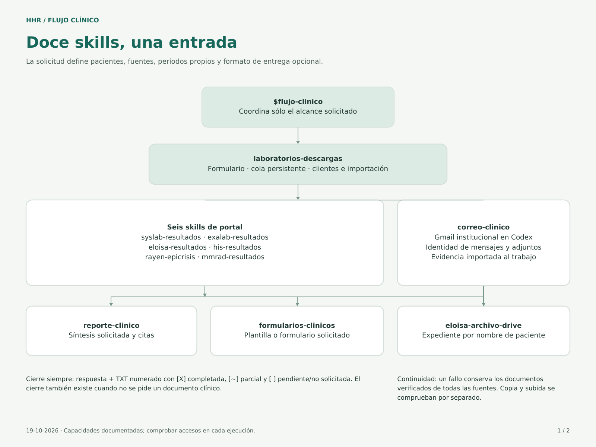
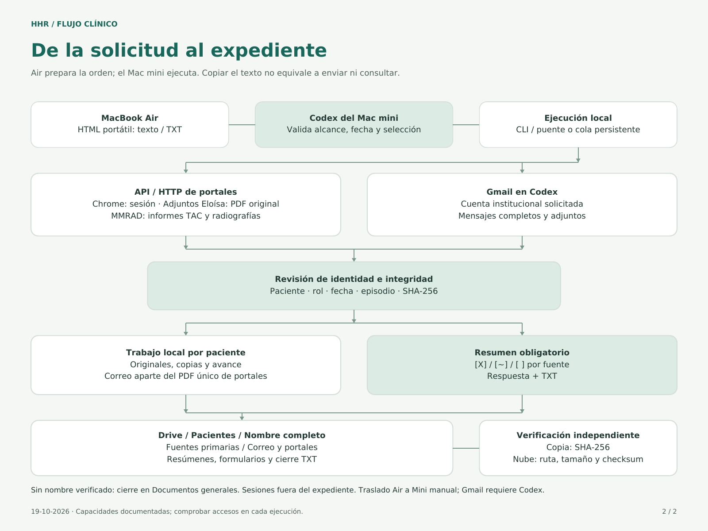

# Flujo clínico HHR

Entrada principal: `$flujo-clinico`. Coordinar las fuentes y etapas solicitadas, con una entrega basal por paciente en cada corrida: [Resumen de antecedentes TXT](../resumen-antecedentes/SKILL.md), además de cualquier formato elegido. Cargar sólo los módulos necesarios, una vez por tarea.

## Mapa visual

Los esquemas muestran las fuentes y el recorrido hasta el expediente por nombre de paciente. Los módulos de redacción incluyen ahora el TXT basal de antecedentes y telereumatología, enrutados en la tabla inferior. Para explicar la arquitectura o modificar accesos/destinos, consultar el [mapa y sus diagramas editables](references/mapa-flujo-clinico.md); [abrir ambos esquemas en PDF](references/esquemas/mapa-flujo-clinico.pdf).

## Alcance

Recuperar pacientes, período, fuentes y entrega del contexto vigente; preguntar juntos solo los datos imprescindibles faltantes. Una agenda aportada puede definir el lote autorizado. No reutilizar pacientes de otras tareas ni ampliar el lote. “Todas las fuentes” incluye las siete fuentes, incluido Eloísa Hospitalizados (`rayen`) y Correo institucional (`email`, daniel.opazo@hospitalhangaroa.cl); no es el valor por defecto. En una revisión integral, incorporar Hospitalizados y Correo al alcance habitual. Una petición limitada a fuentes concretas mantiene ese alcance.

Para buscar, usar RUT autorizados y el [contrato común](../laboratorios-descargas/references/verificacion.md). Para resumir archivos existentes, basta su identidad verificable; no iniciar nuevas consultas. “Solo listar” no descarga documentos ni permite inventar antecedentes del listado. Cada corrida entrega el TXT basal con la evidencia clínica disponible; una instrucción explícita de sólo chat/no guardar prevalece. El cierre TXT también sigue siendo obligatorio salvo instrucción contraria.

## Enrutamiento

| Trabajo | Skill |
|---|---|
| Consultas, descargas, formulario o consolidado | [laboratorios-descargas](../laboratorios-descargas/SKILL.md) |
| Laboratorio HHR / Exalab | [syslab-resultados](../syslab-resultados/SKILL.md) / [exalab-resultados](../exalab-resultados/SKILL.md) |
| Atenciones y adjuntos Eloísa / HIS | [eloisa-resultados](../eloisa-resultados/SKILL.md) / [his-resultados](../his-resultados/SKILL.md) |
| Epicrisis hospitalarias Rayen | [rayen-epicrisis](../rayen-epicrisis/SKILL.md) |
| Correspondencia institucional | [correo-clinico](../correo-clinico/SKILL.md) |
| Informes e imágenes | [mmrad-resultados](../mmrad-resultados/SKILL.md) |
| Síntesis o reporte de datos | [reporte-clinico](../reporte-clinico/SKILL.md) |
| TXT basal obligatorio de cada corrida | [resumen-antecedentes](../resumen-antecedentes/SKILL.md) |
| Resumen de telereumatología con formato del usuario | [telereumatologia](../telereumatologia/SKILL.md), módulo de reporte-clinico |
| Formulario clínico específico | [formularios-clinicos](../formularios-clinicos/SKILL.md) |
| Guardar fuentes y productos | [eloisa-archivo-drive](../eloisa-archivo-drive/SKILL.md) |

Antes de acceder a un portal, leer su skill de fuente. Preferir el cliente programático existente (API o HTTP directo); consultar la [matriz de acceso](../laboratorios-descargas/references/modos-acceso.md) para autenticación y límites de verificación. Chrome interviene cuando se necesita iniciar/renovar sesión o revisar un cambio del portal. El descargador mantiene ejecución/reanudación de seis portales e importación del correo revisado y puede incorporar las epicrisis verificadas al PDF único. El lanzador local incluye las siete fuentes (correo se consulta con Gmail en Codex y se importa), cola guardada, reanudación/cancelación y archivo automático por nombre. Entrega primero documentos; las imágenes se procesan después. Ecocardiogramas: informe PDF adjunto en Eloísa Ambulatorio; imágenes MMRAD excluidas. MMRAD actual: informes TAC y radiografías sin exigir informe. Respetar `attachments` y `ct_reports` del contrato; no ampliar solicitudes antiguas. Para recuperación y optimizaciones leer [acceso y continuidad](../laboratorios-descargas/references/continuidad.md). reporte-clinico define estilo; eloisa-archivo-drive define destino e integridad. No ejecutar de nuevo una etapa ya resuelta solo por cargar otro módulo.

## Entrega

**Fechas de presentación:** usar `DD-MM-AAAA` (ejemplo: `19-10-2026`) para fechas puntuales en nombres y contenido generado: reportes, formularios, estados, índices, gráficos y marcadores de PDF. Los PDF combinados de lectura usan excepcionalmente un rango de meses reales incluidos, p. ej. `Marzo-Sept 2026`. Mantener la precisión disponible, sin inventar día/mes. Conservar los originales descargados y las transcripciones literales; los contratos técnicos, API y estados de reanudación mantienen su formato interno. Usar Pacific/Easter al fechar la generación.

Una fuente parcial **no cancela lo verificado**: entregar y archivar los documentos completos disponibles, incluso de esa fuente, y elaborar el reporte solicitado con ellos. Señalar los faltantes por fuente. Si falla el PDF único, entregar los independientes.

Antes de cerrar una corrida, redactar `DD-MM-AAAA Resumen antecedentes.txt` por paciente con [resumen-antecedentes](../resumen-antecedentes/SKILL.md) y completar el [registro verificable](../laboratorios-descargas/references/entregas-verificadas.md) de la cola. Es predeterminado con `deliveryModel=documents` y se añade a cualquier otro modelo; no amplía consultas. Codex lee y coteja la evidencia; el programa comprueba identidad, fechas, revisión y copias. Exigir estado `archived`, informar sincronización aparte y revisar una entrega `stale` cuando cambian las fuentes. Si el descargador corrió solo, declarar la redacción pendiente; un listado de archivos, un prompt copiado o fuentes completas no cierran esa etapa.

La navegación manual comienza en `Pacientes/Nombre/Lectura y entregas/`: PDF integrados y productos clínicos preparados. Cierres de fuentes, estados, observaciones documentales y verificaciones van en `Control y trazabilidad/`; originales y adjuntos en `Fuentes primarias/`. Aplicar también al reorganizar expedientes previos; ver [archivo por paciente](../eloisa-archivo-drive/SKILL.md).

Cerrar cada orden con el [resumen numerado obligatorio](../laboratorios-descargas/references/cierre-fuentes.md) en la respuesta y en TXT, incluso sin documento de entrega. Añadir ubicación y pendientes. Revalidar los hashes al retomar un trabajo: «completo» no sobrevive a un archivo perdido/modificado. Conservar los originales válidos, marcar actualización pendiente y reanudar solo la fuente afectada. Distinguir obtención de archivos, cobertura de revisión y sincronización; no declarar todas completas si alguna está pendiente.

Instalada en `~/.codex/skills/` del Mac mini. Guía el trabajo con Codex; no cambia las descargas manuales de Chrome ni ejecuta tareas en segundo plano. Otros equipos requieren instalar las skills. Para mantener el mismo entorno y comprobar el paquete, usar la [instalación reproducible](../laboratorios-descargas/references/instalacion.md).

**Estado de capacidades:** consultar [qué está operativo y qué falta](references/estado-capacidades.md) antes de prometer automatización. Biopsias está pendiente: no existe aún un módulo consultable ni se incluye en «todas».

Correcciones de identidad, continuidad, cola y archivo verificadas: [registro del 19-10-2026](references/correcciones-19-10-2026.md).

## Modelo y períodos de la solicitud

Conservar `emailAccount`, `sourceContent`, `deliveryInstructions`, `deliveryModel` y `sourcePeriods` del formulario durante búsqueda, redacción y archivo. Respetar las excepciones al período común por fuente y la [selección de modelo](../reporte-clinico/references/modelos-entrega.json). El formato libre usa sus instrucciones; los modelos institucionales esperan sus plantillas; una descarga completa no significa documento final redactado. Los originales verificados se entregan aunque falte una fuente o una plantilla.

Si llega una solicitud portátil `hhr-clinical-request`, seguir el [contrato Air → Mini](../laboratorios-descargas/references/solicitud-portatil.md). Comprobar que la tarea se ejecuta en el Mini y conservar `asOf`, pacientes, fuentes, excepciones y entrega; copiar el texto no demuestra recepción ni ejecución remota.
