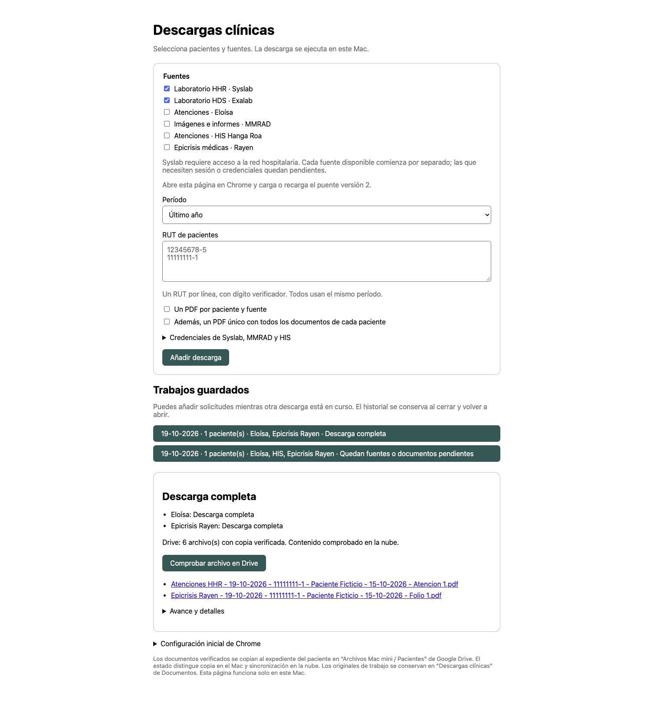

# Correcciones del flujo clínico — 19-10-2026

Implementación local revisada con datos ficticios. No se realizaron consultas nuevas de pacientes ni se modificaron fichas clínicas.

| Corrección | Resultado implementado |
|---|---|
| Identidad en epicrisis | RUN vinculado al encabezado del paciente; rechaza menciones bajo profesional/familiar, encabezados contradictorios y episodio rotulado distinto. Egreso debe coincidir. |
| Reanudación fallida | Conserva archivos cuya integridad sigue comprobada, originales DICOM y PDF único anterior; muestra «Documento obtenido previamente; actualización pendiente». Un archivo modificado no se valida por su sola presencia. |
| Fuentes independientes | Solo prepara accesos disponibles; sesiones se entregan por separado. Credenciales/sesiones ausentes no cancelan lo demás; el llavero bloqueado queda pendiente sin detenerse en un diálogo. |
| Funcionamiento local | Formulario y extensión incluyen Rayen. Copia automática por identidad/nombre, preservación de versiones, cotejo de hashes y verificación remota separada. OAuth renovable preparado. |
| Persistencia y cancelación | Cola atómica, historial, recuperación del checkpoint y reanudación de fuentes pendientes. Cancelación del proceso activo y vigilancia del proceso padre para evitar descargas huérfanas. |
| Pruebas completas | 80 pruebas automatizadas: 45 del motor/lanzador/archivo/OAuth, 19 de Rayen y 16 de puentes. Prueba visual de dos solicitudes, resultado parcial y recuperación tras reiniciar el servidor. |

Las pruebas cubren pacientes diferentes, homónimos, sesión vencida, PDF corrupto/modificado, nueva versión, fallo al reanudar, cancelación con originales conservados, ausencia de credenciales, entrega parcial de sesiones, OAuth/PKCE y comprobación remota simulada. Los clientes de prueba no consultan portales ni escriben al Drive real.

## Activación y límites comprobados

- La carpeta local de Google Drive existe. La copia se verifica por SHA-256; una carpeta homónima sin identidad comprobable queda pendiente, sin mezclar pacientes.
- No hay credenciales OAuth del lanzador en el llavero. La comprobación real de nube queda pendiente hasta configurar el cliente de escritorio y autorizar acceso de solo lectura a metadatos. Procedimiento en [interfaz local](../../laboratorios-descargas/references/interfaz-local.md). No se pidió contraseña de Google ni se extrajeron sesiones de Drive.
- Los archivos de la extensión se actualizan a versión 2. Su activación requiere recargarla en Chrome; Rayen añade permiso para `fichamedico.rayensalud.cl`. La instalación de archivos no demuestra por sí sola que Chrome haya activado el permiso.
- La cola trabaja mientras el lanzador está abierto. Reiniciarlo recupera el historial; las sesiones clínicas vencidas requieren renovarse. No se creó una tarea programada ni un servicio permanente.
- Fechas nuevas visibles y nombres de archivos: DD-MM-AAAA. Parámetros/estados técnicos mantienen ISO; originales clínicos permanecen sin alterar.

[Mapa actualizado](mapa-flujo-clinico.md) · [Motor y pruebas](../../laboratorios-descargas/scripts/tests/test_regression_workflow.py) · [Identidad Rayen](../../rayen-epicrisis/scripts/tests/test_patient_header.py)

## Evidencia visual

Prueba completamente ficticia, incluida la nube simulada: la leyenda de sincronización de esta captura **no acredita una subida a Google Drive real**. El historial conserva un trabajo completo y otro parcial después de reiniciar.

## Revisión adicional de la base

Se reprodujo con datos ficticios que una fuente podía seguir «completa» tras perder documentos al reanudar otra fuente, y que un trabajo completo restaurado no actualizaba su estado/TXT al cambiar archivos. Se unificó la comprobación de integridad para la cola, el cierre y la reanudación; recupera originales válidos y deja pendiente solo la fuente afectada. También se evita certificar nuevamente un PDF modificado usando un hash nuevo. Si desaparece la carpeta de trabajo, el historial señala la pérdida; conserva el resto de órdenes.

«Solo listar» ahora tiene cierre completado sin atribuir descargas. El panel añade un contador, copia del resumen y selección de texto estable entre sondeos. Biopsias queda visible y documentado como pendiente, fuera de las siete fuentes seleccionables. Las diferencias entre capacidades programáticas, pasos en Codex/visor y pendientes se mantienen en [estado de capacidades](estado-capacidades.md).

Validación: 141 pruebas automatizadas (100 motor/lanzador, 19 Rayen y 22 JavaScript), con ocho nuevas regresiones de integridad/cierre. Prueba visual aislada: seleccionar siete fuentes excluye Biopsias; crear/cancelar una orden ficticia conserva su TXT; copiar el cierre y el encargo portátil funciona. Interfaz revisada en escritorio y ancho móvil. No se consultaron pacientes reales ni se certificó el estado actual de los portales. El HTML portátil se comprobó mediante servidor local aislado; no se atribuye una nueva prueba de ejecución `file://`.
