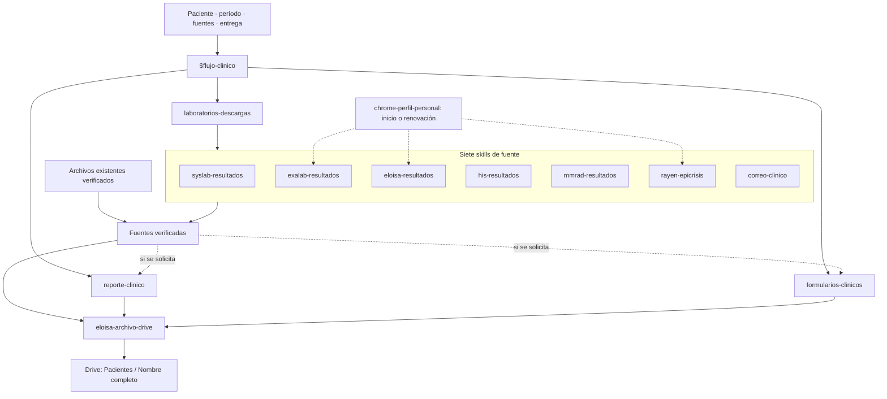
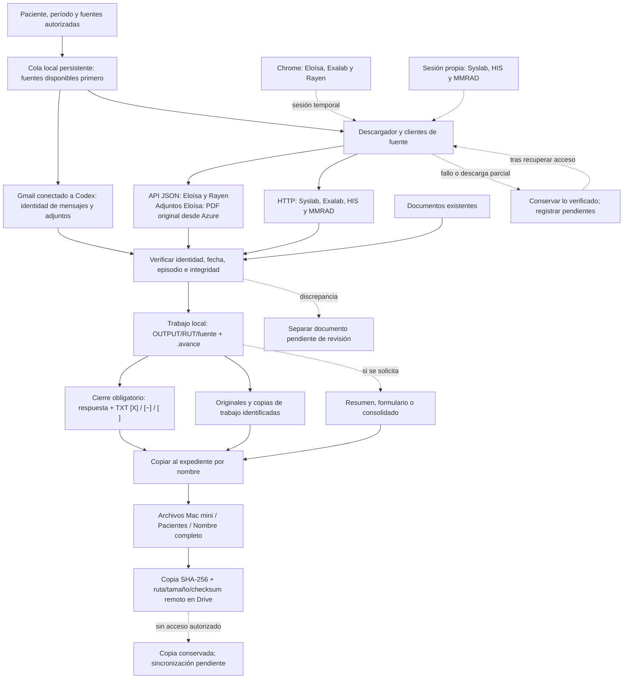

# Mapa del flujo clínico HHR

Arquitectura documentada al 19-10-2026, instalada localmente en el Mac mini. [PDF de los dos esquemas](esquemas/mapa-flujo-clinico.pdf). Este mapa explica capacidades y responsabilidades; la disponibilidad de cada portal se comprueba en la ejecución.

## Organización de las skills

`flujo-clinico` coordina y carga solo los módulos necesarios. `laboratorios-descargas` comparte ejecución, verificación y reanudación entre seis clientes de portal y una importación de correo revisado. `reporte-clinico` define la síntesis; `formularios-clinicos`, el formulario solicitado; `eloisa-archivo-drive`, la copia al expediente. Los productos también pueden partir de archivos existentes verificados, sin abrir portales. El [enrutamiento principal](../SKILL.md) enlaza cada skill.

Las flechas describen coordinación y movimiento de documentos; no implican ejecutar todas las etapas. Consola, puente Codex y formulario local integran siete fuentes; correo usa Gmail en Codex y luego importa su evidencia. El lanzador añade cola persistente y archivo automático por paciente. Una solicitud de solo listar o solo chat conserva esos límites, con cierre operativo TXT obligatorio salvo instrucción posterior contraria.

## Acceso y recorrido de los datos

API JSON y HTTP con formularios/HTML son accesos programáticos distintos. Chrome inicia o renueva las sesiones que lo requieren; los clientes realizan las consultas y descargas. Los detalles de transporte, autenticación y procedencia del PDF están en la [matriz de acceso](../../laboratorios-descargas/references/modos-acceso.md).

- **Área local:** `.trabajos/cola.json` conserva solicitudes, historial y estados; las sesiones permanecen en memoria o llavero. Cancelar conserva los documentos íntegros; al reiniciar se reconstruye el avance y se solicita acceso solo para fuentes pendientes. las rutas técnicas por RUT y `.avance/ID/originales/RUT/fuente/` permiten reanudar y preservar originales. El RUT identifica registros; no da nombre al expediente de Drive. Procesar primero documentos y después imágenes. Conservar DICOM obtenidos además del PDF derivado.
- **Expediente en Drive:** resúmenes, formularios y estado de descargas en `Pacientes/Nombre completo/`; fuentes bajo `Fuentes primarias/`, separadas por origen. Agendas e índices globales van a `Documentos generales/`. Crear solo categorías necesarias. El [archivo por paciente](../../eloisa-archivo-drive/SKILL.md) mantiene el árbol exacto, la ruta local del escritorio, la cuenta y los criterios de copia/verificación.
- **Sesiones:** transferir tokens/cookies por el mecanismo temporal previsto por cada cliente; no copiarlos al expediente ni a registros. Los estados técnicos de reanudación y cachés permanecen locales.
- **Continuidad:** una fuente parcial no invalida los documentos completos de esa fuente ni de las otras. Un error de acceso no equivale a ausencia de registros. En Eloísa, ante actividad inusual, intentar una vez el inicio autorizado, obtener una sesión nueva y reanudar; si persiste un bloqueo/desafío, dejarlo pendiente. Ver [acceso y continuidad](../../laboratorios-descargas/references/continuidad.md).
- **Cierre:** resumen numerado de siete fuentes en respuesta y TXT, incluso sin documento adicional; distinguir documentos obtenidos, cobertura del período y sincronización. La presencia de un archivo en la carpeta local no acredita su subida a la nube.

## Mantenimiento del mapa

Al cambiar fuentes, autenticación, responsabilidades o destinos, actualizar estos Mermaid y las imágenes/PDF enlazados desde `SKILL.md`. Mantener los detalles operativos en sus referencias de origen y usar ejemplos sin pacientes reales. Estos esquemas documentan Codex y el lanzador local. La cola funciona mientras el lanzador está abierto; abrirlo recupera trabajos pendientes. No crean tareas programadas.
